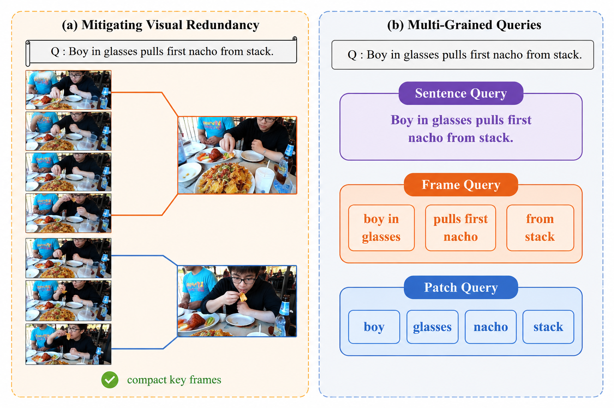
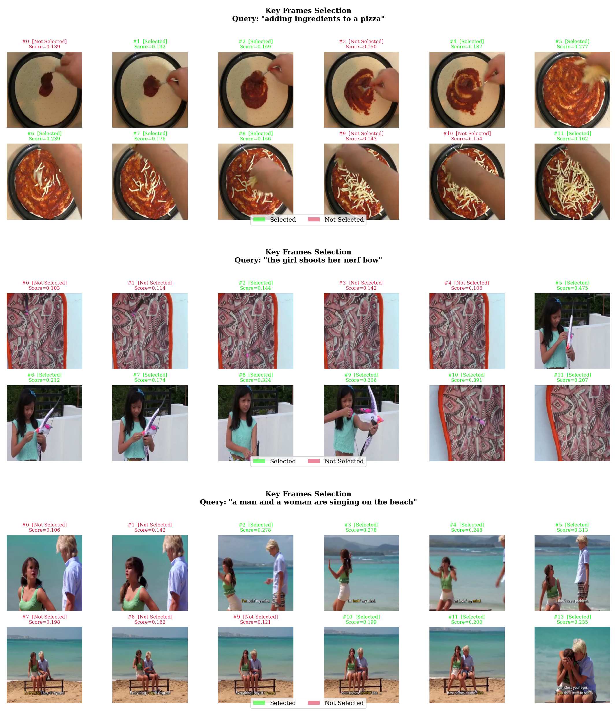
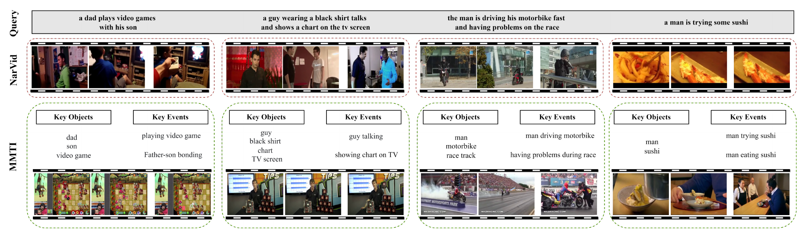

# MMTI

This repository provides the implementation of our paper **Text-Video Retrieval via Multi-Dimensional Saliency Assessment and Granularity-Aware Query Decomposition**.

[Paper](https://arxiv.org/abs/2609.38949)

## Introduction



Videos contain redundant frames and background regions, while a single global text embedding can overlook temporal events and spatial details. We propose MMTI to address these challenges by selecting informative visual features and decomposing text queries for multi-grained alignment.

MMTI consists of two main components:

- **Key Feature Selection (KFS)** selects and aggregates informative frames and patches through multi-dimensional saliency assessment.
- **Text-Video Interaction Module (TVIM)** decomposes each text query into sentence, frame, and patch queries for semantic alignment at complementary granularities.

## Qualitative Results



**Key frame selection.** These examples from Figure 1 of our supplementary material illustrate how KFS identifies informative frames. Green labels mark selected anchor frames, and red labels mark unselected frames. Each example includes the text query and frame importance scores.



**Text-to-video retrieval.** These examples from Figure 3 of our supplementary material compare MMTI with NarVid. Green boxes show correct top-1 results from MMTI, and red boxes show incorrect results from NarVid. The annotations highlight the objects and events described by each query.

## Requirements

The provided scripts are intended for Linux with an NVIDIA GPU and a CUDA-compatible driver. You can create the environment and install the dependencies with the following commands:

```sh
conda create -n mmti python=3.8 -y
conda activate mmti
conda install --yes -c pytorch pytorch=1.7.1 torchvision=0.8.2 cudatoolkit=11.0 numpy=1.23.5
pip install "pillow<10" "opencv-python<4.9" "pandas<2.1" ftfy regex tqdm boto3 requests nltk
```

## Data Preparation

Please refer to [CLIP4Clip](https://github.com/ArrowLuo/CLIP4Clip#data-preparing) for dataset annotations and preparation, and [Collaborative Experts](https://github.com/albanie/collaborative-experts/tree/master/misc/datasets) for benchmark splits.

Once the datasets are ready, please update the following paths in the corresponding scripts under [`scripts/`](scripts/) to match your local setup:

- **Annotations:** `--train_csv`, `--val_csv`, `--test_csv`, `--data_path`, and `--multi_data_path`, where applicable.
- **Videos:** `--features_path`.

## Training and Evaluation

We provide scripts to help you train and evaluate MMTI. Please run the commands below from the repository root. Before getting started, please check the dataset paths and adjust `CUDA_VISIBLE_DEVICES` in the corresponding scripts to match your GPU setup.

### CLIP Backbone

The scripts use CLIP ViT-B/32 as the backbone. You can download its pretrained weights with:

```sh
wget -P modules https://openaipublic.azureedge.net/clip/models/40d365715913c9da98579312b702a82c18be219cc2a73407c4526f58eba950af/ViT-B-32.pt
```

### Training

To train MMTI on MSR-VTT 1k-A, you can run:

```sh
bash scripts/train_msrvtt_vit32.sh
```

Training checkpoints are saved to the directory specified by `OUTPUT_DIR` in the [training script](scripts/train_msrvtt_vit32.sh). The provided scripts use a single GPU as an example configuration. For the settings used in our experiments, please refer to the [paper](https://arxiv.org/abs/2609.38949).

### Model Weights

**Model weights:** [Baidu Netdisk](https://pan.baidu.com/s/19TeLhCUFQjt7dR1nceYtCQ?pwd=zuq6).

### Evaluation

To evaluate on MSR-VTT 1k-A, please set `--init_model` in the [evaluation script](scripts/eval_msrvtt_vit32.sh) to your checkpoint file and `--output_dir` to your preferred output directory. You can load the checkpoint directly from its saved location, then run:

```sh
bash scripts/eval_msrvtt_vit32.sh
```

We also provide evaluation scripts for [MSVD](scripts/eval_msvd_vit32.sh), [ActivityNet Captions](scripts/eval_activitynet_vit32.sh), and [DiDeMo](scripts/eval_didemo_vit32.sh). Please update the dataset paths, checkpoint (`MODEL_PATH`), and output directory (`OUTPUT_DIR`) in the corresponding script before running it.

## Citation

If you find MMTI useful in your research, please consider citing our paper:

```bibtex
@article{wei2026mmti,
  title   = {Text-Video Retrieval via Multi-Dimensional Saliency Assessment and Granularity-Aware Query Decomposition},
  author  = {Wei, Shuquan and Chen, Xi and Chen, Xu and Jia, Xiangyang},
  journal = {arXiv preprint arXiv:2609.38949},
  year    = {2026}
}
```

## Acknowledgements

This implementation builds on [EERCF](https://github.com/adxcreative/EERCF). We sincerely thank the authors for their work and for sharing their code with the research community. We also thank the authors of [CLIP4Clip](https://github.com/ArrowLuo/CLIP4Clip) and [Collaborative Experts](https://github.com/albanie/collaborative-experts) for providing helpful dataset preparation resources.

Questions and suggestions are welcome. If you encounter any issues when using this repository, please feel free to contact us.
